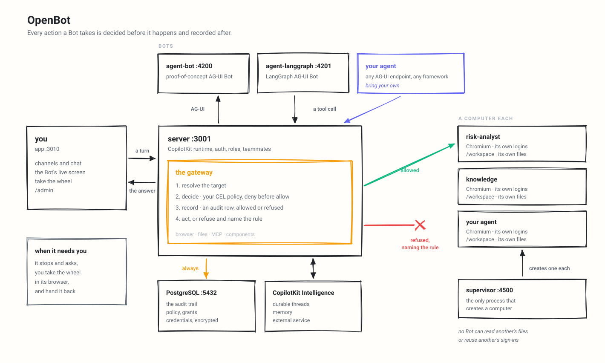

<div align="center">

# OpenBot

**你的公司真正拥有的 AI 助手。** 和 ChatGPT、Claude 或 Grok 是同一副样子，只有一个关键区别：它运行在你自己的基础设施上，并且你可以改动它的任何部分。任何 agent 技术栈，都能通过 AG-UI 接入。

每个同事（coworker）都有一台属于自己的电脑：一个带有自己登录状态的真实浏览器、自己的文件，以及只在你授权范围内可用的工具。每个动作都在发生之前被决定，在发生之后被记录。

[**联系工程师**](https://copilotkit.ai/talk-to-an-engineer?ref=openbot_readme) · [**让我们帮你搭建**](https://copilotkit.ai/talk-to-an-engineer?ref=openbot_readme) · [**copilotkit.ai/openbot**](https://copilotkit.ai/openbot) · [**快速开始**](#快速开始) · [**文档**](docs/README.md) · [**English**](README.md)

[](https://github.com/CopilotKit/openbot/actions/workflows/ci.yml)
[](https://github.com/CopilotKit/openbot/actions/workflows/security_zizmor.yml)
[](./LICENSE)


[](https://trendshift.io/repositories/175080)

</div>

https://github.com/user-attachments/assets/535ef7ee-1631-4a69-b839-564c56cf90b4

<div align="center">

把你用任何框架编写、或干脆手写的 AG-UI agent 接进来，它就会成为一个拥有自己频道的同事。
在它自己的屏幕上看它工作，在它遇到不该独自处理的事情时接过操作权，然后再交还给它。
它用组件而不是只用文字来回答，而这一切都运行在你自己的机器上。

</div>

> **这是一个模板，不是成品。** OpenBot 的设计意图是被克隆后改成你自己的东西。没有可供注册的托管版本，这里也没有任何东西作为包发布供你依赖：本仓库中的每个 workspace 都是私有的。你拿走这个仓库，把 `examples/` 下的示例租户包替换成你自己的同事、频道和技能，然后运行它。下面描述的只是一个起点，而不是某个别人替你运维好的成品。

> **Alpha 阶段，仍在积极开发中。** OpenBot 还很早期。请预料到粗糙的边角和 bug，也请预料到它会变化。欢迎提交 issue 和 pull request。

> **在你自己的机器上运行。** 下面的内容都是为笔记本电脑写的。`.env.example` 带有 `OPENBOT_SINGLE_USER=true`，它会把每个请求都当作同一个管理员放行，因此一份新克隆的仓库无需先注册 OAuth 客户端就能用上产品。[登录](#登录)会关掉它，并且在其他人能够访问这个部署之前必须关掉。

> **我们可以在你的公司为你搭建，或与你一起搭建。** 我们的工程师会把 OpenBot 立在
> 你的基础设施内部，定制成看起来像你自己产品的东西，然后交还给
> 你继续改动。[**开始沟通**](https://copilotkit.ai/talk-to-an-engineer?ref=openbot_readme)。
>
> 与此同时，你可以把它全部跑在笔记本电脑上，Intelligence 也包括在内：CopilotKit 免费的开发者套餐
> 覆盖了[在本地运行 Intelligence](#在自己的机器上运行-intelligence)，在 Mac 上用 Docker 即可。

## 它是什么

一个运行在你自己基础设施内部的 agent 平台。Docker Compose 把它的每个部分拉起来，数据放在你的 PostgreSQL 里，模型由你自己选择：模型不随盒子一起发布，由管理员提供凭据，凭据在静态下加密，并且从不记入日志。

一个部署从两个同事开始，它们是配置而不是代码：负责日常工作的 **General Assistant**，和负责公司问题的 **Knowledge**。配置好端点后 **Risk Analyst** 会加入它们，另外十个在 `examples/fintech/catalog/` 里等着，每个只做一件事——按政策原文审阅一笔报销、把会议记录变成其中真正的后续事项、根据已发布的内容起草发布说明、分诊一个工单、按手册回答新入职者、写一份说明它没能找到什么的简报、撰写面试记录、交接一个值班班次、在续约前汇总已知信息、以及把客户反馈归组成它能引用的主题。把一个拷进 `examples/fintech/agents/` 即可添加，你也可以在那里或 `agents.yaml` 里写自己的，或者在 UI 里从 `/bots` 创建一个。

Bot 对一台电脑、一个文件、一个 MCP 服务器或一个组件做的任何事，都要经过同一个网关，由它决定并记录。这就是「一个能使用你工具的 agent」和「一个你敢放到工具旁边的 agent」之间的区别。

更多内容见 [copilotkit.ai/openbot](https://copilotkit.ai/openbot)。

## 建立在 AG-UI 之上

Bot 就是任何讲 [AG-UI](https://github.com/ag-ui-protocol/ag-ui) 的端点，这是 agent 与用户交互的开放协议，所以 OpenBot 不绑定任何框架，你也不会被绑定。用 LangGraph、Mastra、CrewAI、Pydantic AI、Google ADK 构建的 agent 和手写的 agent 都以同样的方式接入，而治理跟着协议走，而不是跟着框架走。

<picture>
  <source media="(prefers-color-scheme: dark)" srcset="assets/architecture-dark.svg">
  
</picture>

## 环境要求

- Docker，用于 PostgreSQL 和随附的 Bot。
- [Bun](https://bun.sh) 1.3+，用于应用和 API 服务器。
- 一个 CopilotKit Intelligence 项目和许可证。有免费套餐，Intelligence 也可以自托管。
- 一个模型密钥。概念验证 Bot 使用 OpenAI；LangGraph Bot 可以使用 OpenAI、Anthropic 或 Google。

## 快速开始

> **用 AI 助手来搭建？** 先把 [`prompt.txt`](prompt.txt) 粘贴给它。它带着
> 和下面相同的步骤，外加那些容易搞错的地方：`.env.example` 里空着的密钥
> 哪些其实该由你填（CopilotKit 密钥和模型密钥），哪些由启动
> 脚本帮你填，以及每次启动拒绝是什么意思。其中每个说法都对照
> 本仓库核对过。

1. 创建 `.env`：

   ```sh
   cp .env.example .env
   bun install
   ```

2. 连接一个新的托管 Intelligence 项目：

   ```sh
   npx --yes copilotkit@latest login
   npx --yes copilotkit@latest project select
   bun scripts/setup-learning.ts
   ```

   这个助手会为选中的项目申请运行时密钥，创建或复用它的
   `openbot` Learning 容器，然后把两项设置写入 `.env`。它会保留
   自定义的容器分配，并且从不替换已有的 OpenBot 密钥；如果已经有一个
   密钥，它只在该密钥的项目里缺少 `openbot` 时才创建。
   如果是全新的自托管搭建，把 `INTELLIGENCE_API_URL` 设为那个部署的
   HTTPS API 源（本地部署则用 `http://localhost`），并在没有那两条 `npx` 命令的情况下运行该助手。它会打开一个隔离的 Chrome 或 Edge 窗口供你
   正常登录和选择项目；请先装好其中一个浏览器。它写入
   API 地址、密钥和容器，但不写 `INTELLIGENCE_GATEWAY_WS_URL`，所以
   那一个要你自己指向同一个部署。`openbot` 存在后，服务器会自己
   把它设为默认，除非 [Admin → Automatic Learning](docs/automatic-learning.md)
   里已有保存的设置。
   托管 Intelligence 不需要单独的许可证令牌。

3. 填写其余必填项：

   - `OPENAI_API_KEY`

   除非你自己运行 Intelligence，否则请保留 `.env.example` 里的托管 Intelligence 地址。示例中的 `KEY_ENCRYPTION_KEY` 是公开的，本地用没问题；用下面的命令生成你自己的：

   ```sh
   openssl rand -base64 32
   ```

4. 运行：

   ```sh
   bash scripts/start.sh
   ```

5. 打开 <http://localhost:3010>。

`scripts/start.sh` 会启动 Docker 服务、应用迁移、在 3001 端口启动 API 服务器、启动例行任务 worker、在 3010 端口启动应用，并在打印后续步骤之前检查这些服务是否能应答各自的健康检查路由。

`scripts/stop.sh` 会把同样的东西停掉，包括每个 Bot 的电脑——compose 并不拥有它们；`--keep-computers` 会保留电脑继续运行。不会有任何东西被删除：数据库、Bot 的文件和它们的浏览器配置文件都是卷。

### 在自己的机器上运行 Intelligence

想在一台 Mac 上试用 Intelligence 而不是托管服务，请按
[Evaluate Intelligence locally](https://docs.copilotkit.ai/intelligence/self-hosting-local) 操作。免费的
[开发者套餐](https://www.copilotkit.ai/pricing) 符合条件。本地许可证持续 30 天，
只要你的账户状态正常，`npx copilotkit@latest local renew` 可以按需续期。它是 macOS 加 Docker Desktop 的
预览版，不是生产安装。在有 `.env` 的 OpenBot 根目录下运行它的
`npx copilotkit@latest local connect`。

该命令会把 `INTELLIGENCE_API_URL`、`INTELLIGENCE_GATEWAY_WS_URL` 和
`CPK_INTELLIGENCE_API_KEY` 写入 `.env`。OpenBot 原样读取前两个，但项目
密钥只从 `INTELLIGENCE_API_KEY` 取，缺了它就拒绝启动，所以在 `bash scripts/start.sh` 之前把 `cpk-...` 那个值
复制过去：

```sh
INTELLIGENCE_API_KEY=cpk-...   # CPK_INTELLIGENCE_API_KEY 的值
```

要让 Bot 在那套栈上也有 Learning 容器，见
[Automatic Learning](docs/automatic-learning.md)。

## 部署它

一个镜像包含应用、API、Bot 驱动的浏览器，以及可选的 PostgreSQL。用同一个
`.env`，不需要 Kubernetes。

```sh
# 已发布的镜像。无需克隆，也无需构建。
docker run -p 3001:3001 --env-file .env \
  -e EMBEDDED_POSTGRES=on -v openbot-data:/var/lib/postgresql \
  ghcr.io/copilotkit/openbot:latest

# 或者用你面前的这份代码树。
docker build -t openbot .
docker run -p 3001:3001 --env-file .env \
  -e EMBEDDED_POSTGRES=on -v openbot-data:/var/lib/postgresql openbot
```

这里全部走 3001，应用也在内，而不是克隆版用的 3010。`latest` 是最新发布版，`:v0.0.9` 这样的版本标签则固定某一个。

不设 `EMBEDDED_POSTGRES`，并让 `DATABASE_URL` 指向你已经在运行的数据库。
[docs/deployment.md](docs/deployment.md) 有最低配置、各平台说明，以及在多个副本之后的行为。

## 试一试

- 打开 `/bot` 并问：`Open news.ycombinator.com and tell me the top story.`
- 让 Bot 填写 <https://httpbin.org/forms/post>，然后查看 `/admin/audit`。
- 打开 `/admin/boundaries`，加一条 deny 规则或预设，然后重试同一个浏览器操作。
- 从 `/bots` 创建一个 Bot，给它一个长期职责，并和它开一个频道。

## 主要界面

| 路由                       | 用途                                                            |
| --------------------------- | ------------------------------------------------------------------ |
| `/`                         | 开始并浏览频道。                                         |
| `/channel/new`              | 开始一个对话；在 To: 里放两个或更多 Bot 即建群。       |
| `/channel/:id`              | 与一个同事对话，看它的屏幕，并看它运行了什么。 |
| `/bot`                      | 直接与 Bot 对话；`?agent=<id>` 选择一个。                 |
| `/bots`                     | 你能触达的每个 Bot；创建一个，并打开它的页面修改。 |
| `/bots/:id`                 | 一个 Bot：它在等你什么、它在做什么，以及它是怎么配置的。 |
| `/bots/:id/responsibilities` | 给 Bot 一个长期目标，跟进它的进度，并决定它何时该工作。 |
| `/bots/:id/reach`           | 在 Slack、Microsoft Teams 或短信中继续与 Bot 对话。 |
| `/bots/:id/memory`          | 哪些已连接的应用在为 Bot 提供事实，以及它的后台研究。 |
| `/bots/:id/approvals`       | Bot 哪些事可以不先问你。                      |
| `/connections`              | 连接你的应用，让你的 Bot 能用它们工作。                 |
| `/capabilities/skills`      | 创建并启用个人技能。                                 |
| `/capabilities/memory`      | 你的 Bot 记得你什么，以及你告诉它们的事实。        |
| `/routines`                 | 查看正在生效的例行任务，并停掉一个。                  |
| `/settings`                 | 用户偏好。                                                  |
| `/settings/passwords`       | 你把 Bot 登录网站时保存的登录信息。               |
| `/settings/notifications`   | 更新发到哪里、你的设备，以及最近的投递记录。   |
| `/settings/approvals`       | Bot 行动前是否询问，以及每个 Bot 的规则。      |
| `/admin/credentials`        | 存储只写加密凭据。                            |
| `/admin/approvals`          | 团队审批设置、团队规则，以及共享账号申请。   |
| `/admin/computers`          | 查看、停止和重置 Bot 电脑。                               |
| `/admin/boundaries`         | 配置浏览器/文件/MCP 操作策略。                          |
| `/admin/components`         | 发布组件，并管理哪些 Bot 可以用它们。             |
| `/admin/playground`         | 在浏览器中起草并发布沙盒组件。             |
| `/admin/plugins`            | 配置 MCP 服务器，并把它们的工具授给 Bot。               |
| `/admin/skills`             | 编写部署级技能，并把它们授给 Bot。                    |
| `/admin/learning`           | 给 Bot 分配 Learning 容器，或暂停 Automatic Learning。   |
| `/admin/people`             | 列出、提升、降级和移除已登录的人。       |
| `/admin/identity-providers` | 注册公司的 SAML 或 OIDC 提供方，按邮箱域名路由。  |
| `/admin/enterprise`         | 成员可以用什么、Bot 电脑如何联网，以及关于此记录了什么。 |
| `/admin/audit`              | 查看被允许、被拒绝和失败的操作。                     |

## 特性

- **每个 Bot 一台电脑**：supervisor 给每个 Bot 自己的容器、自己的 `/workspace` 卷和自己的浏览器配置文件。设 `COMPUTER_RUNTIME=runsc` 可在主机支持时让它们跑在 gVisor 之下。
- **是 shell，不只是浏览器**：Bot 可以在自己的工作区里运行命令、安装它需要的东西，并处理它保存的文件。走的门和其他一切一样，因此一条规则可以整体拒绝 shell，或拒绝特定命令，而无论哪种情况命令都在记录里。命令继承 PATH、locale、终端和代理变量，但不继承部署环境的其余部分。
- **网关是唯一入口**：它从服务器持有的快照解析目标、评估策略、写入审计行，然后才调用电脑。没有任何路径能在记录存在之前就行动。
- **CEL 策略，失败即关闭**：规则可以检查 `tool.name`、`intent`、`bot.id`、`actor.id`、`page.url`、`page.host`、`element.*`、`key`、`command`、`file.*`、`mcp.*` 和 `initiator.*`（是什么启动了这次运行，因此一条规则可以拒绝一个计划任务，而放行同一个人）。deny 在 allow 之前求值，没有策略就什么都不允许，而一条坏规则会拒绝而不是放行。
- **看它在做什么**：屏幕显示 Bot 正在看什么，旁边的 Activity 标签页显示它运行、读取和保存了什么，以及输出。对话记录里的一行命令会打开同样的东西。已保存的文件显示路径和大小，从不显示内容。
- **接过操作权**：撞到登录墙或 2FA 提示的 Bot 会求助。控制在同一个面板里移交，并记录为 `computer.help_requested`、`computer.control_taken` 和 `computer.control_released`。在人驾驶期间，Bot 的操作会被拒绝而不是排队。
- **密钥从不进入对话记录**：轨迹记录的是请求过某个密钥以及它持续了多久，而不是它说了什么。
- **带自己的 agent**：任何 AG-UI 端点都是一个 Bot，可以来自框架也可以手写。端点用与浏览器导航相同的目标检查来验证，认证头以只写方式存储。
- **用组件而不是文字**：编译后的 React 组件放在 `app/src/components/gallery/`，沙盒的在 `/admin/playground` 里编写并发布，无需部署。每次调用都会问服务器这个组件是否存在、是否已发布，以及是否未对该 Bot 扣留。数据函数按组件逐个授权。
- **受治理的 MCP**：Google Drive、Notion 和 [公共网页研究提供方](docs/web-research.md) Parallel、Exa 与 Firecrawl 都在目录里，Composio 在一个账号背后代理几百个应用，每个都以发起人的身份触达。目录只收录这个部署愿意背书的厂商，因此添加一个是厂商审查。自定义服务器必须通过 URL 检查；未知工具和自定义服务器的工具都被当作写操作，而服务器有宣传但未标记为写操作的目录工具归类为读。Bot 会被告知这里存在哪些连接器、它持有哪些，所以它会说自己未被授予某个连接器，而不是去浏览厂商的网站。
- **技能是指令，不是能力**：个人技能只附加到其作者拥有的 Bot 上，部署级技能归管理员所有，两者都在输入框里用 `/` 调用。被授予随附 `skill-creator` 技能的 Bot 可以在对话中和你一起写一个，并且只在你按下卡片上的按钮时才保存。
- **用公司已有的东西登录**：来自环境的 Google、Microsoft 或 Okta，或公司在部署运行时注册、按邮箱域名路由的自有 SAML 或 OpenID Connect 提供方。任意一个就能打开登录；也可以同时配置多个。
- **决定谁能进来**：`/admin/people` 列出所有已登录的人，提升和降级他们，并移除访问权限——这会结束他们正在使用的会话并阻止下次登录。每次更改都在审计轨迹上。
- **读得懂的审计轨迹**：`/admin/audit` 列出什么被允许、什么被拒绝、什么失败了，每次拒绝都带着导致它的规则。
- **凭据静态加密**：通过 `/admin/credentials` 存储，API 从不返回，并在审计事件中脱敏。
- **默认只走回环**：电脑绑定 `127.0.0.1` 并要求每容器令牌，因此没人能靠知道端口就够到一个已登录的浏览器。supervisor 也绑定在那里，因为它持有 Docker socket，而它的令牌是共享密钥，不是网络边界。
- **持久的对话线程和记忆**：对话通过 CopilotKit Intelligence 在重启后存活，每个部署会给自己拥有的线程盖上标记。
- **例行任务**：让 Bot 按时间表做一件事，它就会做，以你的身份、在你提问的频道里运行。15 分钟的下限和 20 个已启用例行任务的上限，防止一句话排下人没打算排的量，连续失败十次会关掉一个例行任务，而不是永远烧模型费用。需要一个 worker 进程，`scripts/start.sh` 会在本地启动它；见 [docs/routines.md](docs/routines.md)。

## 带自己的 agent

任何 AG-UI 端点都可以是一个 Bot。

在 `/bots` 创建 Bot 时需要：

- 名称、头衔和角色描述；
- 私有或公开可见性；
- 可选的 AG-UI 端点；
- 可选的只写认证头。

服务器用与浏览器导航相同的目标检查来验证 agent 端点，注册时验一次，端点每次重定向时再验一次。如果没有设置自定义端点，产品创建的同事会在配置了 `MANAGED_AGENT_AG_UI_URL` 时使用它，没配置时则被拒绝。

私有地址会被拒绝，除非它列在 `AGENT_ENDPOINT_ALLOWED_HOSTS` 里：

```sh
AGENT_ENDPOINT_ALLOWED_HOSTS=agents.internal,10.0.0.42:9000
```

单独一个主机覆盖该主机上的任何端口；带端口的主机则钉死那个端口。匹配是精确的：没有通配符，没有后缀。写成 URL 的条目，或含 `*` 的条目，会让启动停止并指出那个条目。

这个列表只覆盖 agent 端点。浏览不受影响，持有部署自己云凭据的地址无论列了什么都会被拒绝，而列出一个地址只是允许在那里注册一个 agent，并不授予那个 agent 任何东西。

租户包 agent 声明在包自己的 `agents.yaml` 里，在 `TENANT_PACKAGE_DIR` 指定的目录里（默认 `examples/fintech`），或该包 `agents/` 目录下各自一个文件，形式为二者之一：

- `built-in`，带一个系统提示；或
- `remote-ag-ui`，带一个端点。

见 [docs/configuration.md](docs/configuration.md) 和 [docs/coworkers.md](docs/coworkers.md)。

## 配置

`.env.example` 是源模板。缺少下面这些，API 服务器会拒绝启动：

- `DATABASE_URL`
- `KEY_ENCRYPTION_KEY`
- `INTELLIGENCE_API_URL`
- `INTELLIGENCE_GATEWAY_WS_URL`
- `INTELLIGENCE_API_KEY`

`COPILOTKIT_LICENSE_TOKEN` 是可选的。自带
许可证的自托管 Intelligence 仍然可以设置它，它会被转发给运行时；托管 Intelligence
不签发它，启动也不再要求它。自托管的 Intelligence
还需要在自己那份部署上有该许可证，否则它会拒绝记忆；缺少时 OpenBot 会在
启动时记录 `intelligence-entitlement-not-ready`。

值得知道的设置：

| 变量                             | 用途                                                                       |
| ------------------------------------ | ------------------------------------------------------------------------- |
| `OPENBOT_SINGLE_USER`                | 把每个请求都当作同一个管理员放行。未配置身份提供方时必需；`.env.example` 默认开启。 |
| `OPENAI_BASE_URL`                    | 让 OpenAI 形状的调用发往别处：一个网关、一个代理。  |
| `ANTHROPIC_BASE_URL`、`GOOGLE_GENERATIVE_AI_BASE_URL` | 同上，用于那两个 API。            |
| `COMPUTER_TOKEN`                     | 每个 Bot 电脑请求都必须出示的密钥。`start.sh` 会回退到一个固定的开发值。 |
| `SUPERVISOR_TOKEN`                   | supervisor 要求的密钥。`start.sh` 会回退到一个固定的开发值。 |
| `AGENT_TOOL_TOKEN`                   | Bot 回调已授权工具时出示的密钥。`start.sh` 会设置一个。没有它，任何 Bot 都不能调用工具。 |
| `COMPUTER_SUPERVISOR_URL`            | 让每个 Bot 有自己的一台电脑，而不是共用一台。      |
| `COMPUTER_RUNTIME`                   | 设为 `runsc` 可让电脑跑在 gVisor 下，前提是主机有它。      |
| `COMPUTER_SANDBOX`                   | 设为 `on` 启用 Chromium 自己的沙盒，前提是主机允许。        |
| `EMBEDDED_POSTGRES`                  | 设为 `on` 在部署容器内放一个数据库。               |
| `AGENT_COMPUTER_POLICY`              | JSON 操作策略。JSON 畸形会阻止服务器启动。                  |
| `AGENT_COMPUTER_ALLOW_PRIVATE_HOSTS` | 让 Bot 够到本机自己的服务。仅限本地，`NODE_ENV=production` 下会拒绝启动。 |
| `AGENT_ENDPOINT_ALLOWED_HOSTS`       | agent 可以注册在哪些私有地址，逗号分隔。一个主机，可带端口。 |
| `TENANT_PACKAGE_DIR`                 | 存放租户 YAML 的目录。默认 `../examples/fintech`。      |
| `DEPLOYMENT_ID`                      | 两个部署共用一个 Intelligence 项目时，为这个部署命名。            |
| `OPENBOT_SELF_HOST_BANNER`           | 设为 `false` 隐藏那条提供 CopilotKit 自托管帮助的横幅。付费 Intelligence 套餐上它从不显示。 |

完整参考：[docs/configuration.md](docs/configuration.md)。

## 架构

| 服务                  | 端口                       | 用途                                                                                          |
| ------------------------ | -------------------------- | ------------------------------------------------------------------------------------------------ |
| `app`                    | 3010                       | React/Vite UI。                                                                                   |
| `server`                 | 3001                       | Hono API、CopilotKit 运行时、认证、策略、审计、插件、组件、同事和频道。 |
| `agent-computer`         | 4100                       | Chromium 加 `/workspace` 和浏览器配置文件。                                                  |
| `agent-bot`              | 4200                       | 概念验证 AG-UI Bot。                                                                          |
| `agent-langgraph`        | 4201                       | LangGraph AG-UI Bot。                                                                             |
| `supervisor`             | 4500 主机 / 4300 容器 | 为每个 Bot 创建并管理一台电脑。                                                        |
| `worker`                 | 无                       | 把到期的例行任务逐个交给服务器来触发。                                            |
| PostgreSQL with pgvector | 5432                       | 产品数据、策略、审计、凭据、授权、频道和组件元数据。              |
| CopilotKit Intelligence  | 外部         | 持久的对话线程和记忆。      |

服务器网关是 Bot 浏览器和文件工具调用的产品/API 路径。
它解析目标、评估策略、写入审计行，然后才调用
`agent-computer`。电脑也暴露较低层的令牌保护服务
端点；请把它们保持私有，不要用它们绕过网关。

更多细节：[docs/architecture.md](docs/architecture.md)。

## 登录

`.env.example` 带有 `OPENBOT_SINGLE_USER=true`，这就是一个管理员且无需登录：一份新克隆的仓库不注册 OAuth 客户端就能用上产品的方式。删掉那一行，并在其他人够到该部署之前配置 Google、Microsoft 或 Okta 中的**任意一个**。两者都没有时，它会拒绝启动，而不是把所有人都当成管理员放行。配置多个提供方，登录界面会把每一个都列出来。

无论选哪个，这四项都是必需的：

```sh
BETTER_AUTH_URL=http://localhost:3001        # OAuth 回调回到哪里
BETTER_AUTH_SECRET=                          # openssl rand -base64 32
TRUSTED_ORIGINS=http://localhost:3010        # 应用从哪里提供服务
INITIAL_ADMIN_EMAILS=you@example.com         # 逗号分隔
```

然后是提供方。注册它旁边显示的重定向 URI。

```sh
# Google — http://localhost:3001/api/auth/callback/google
GOOGLE_OAUTH_CLIENT_ID=
GOOGLE_OAUTH_CLIENT_SECRET=

# Microsoft — http://localhost:3001/api/auth/callback/microsoft
MICROSOFT_OAUTH_CLIENT_ID=
MICROSOFT_OAUTH_CLIENT_SECRET=
MICROSOFT_OAUTH_TENANT_ID=common             # 仅员工用你的目录 GUID

# Okta — http://localhost:3001/api/auth/callback/okta
OKTA_OAUTH_CLIENT_ID=
OKTA_OAUTH_CLIENT_SECRET=
OKTA_OAUTH_ISSUER=https://example.okta.com/oauth2/default
```

重启。账号、会话和角色和其他一切存在同一个 PostgreSQL 数据库里。

公司自己的 SAML 或 OpenID Connect 提供方在部署运行时注册，位置在
Admin → Identity providers，按邮箱域名路由。OIDC 注册需要把提供方
发现文档里的每个主机都列进 `TRUSTED_ORIGINS`，而不只是 issuer。

- `INITIAL_ADMIN_EMAILS` 是必需的，因为它就是授予第一个管理员的东西。之后
  `/admin/people` 可以提升其他人，但写在这里的地址保持管理员身份，无法在该界面被
  降级或移除。每次登录都会重新读它，所以改动会在那个人
  下次登录时生效。
- `MICROSOFT_OAUTH_TENANT_ID` 默认是 `common`，它同时放行个人 Microsoft 账号和
  工作账号。在多租户应用注册上，Entra 可能根本不发 `email` claim，因此
  OpenBot 回退到 `upn`，再回退到 `preferred_username`。如果三者都没来，
  登录会被拒绝并记录原因：把 `email` 加成可选 claim，或在这里使用你的
  目录 GUID。
- 配置了一半的提供方会在启动时被拒绝，而不是等某人第一次尝试登录
  时：有 client id 没有 secret、`BETTER_AUTH_SECRET` 短于 32 个字符，或 Okta issuer 背后没有
  凭据。
- **SAML 和 OIDC** 在部署运行时注册，而不是在这里配置。以管理员身份
  登录，带着身份团队给你的元数据去 Admin → Identity providers。
  之后人们通过输入邮箱地址登录，域名决定他们被送到哪个提供方。
- **给任何部署前面放 TLS。** 在非 localhost 上用明文 `http://` 提供的页面
  不是安全上下文，登录 cookie 需要 `Secure`。

### 桌面安装的企业登录

面向员工桌面，请用上面的 Google、Microsoft 或 Okta
设置来准备一个 OpenBot 授权方（你的 Kubernetes OpenBot 可以承担这个角色）。在桌面连接界面设置 **Organization OpenBot URL**，
或在它的公开配置里设 `OPENBOT_ORGANIZATION_AUTH_URL=https://openbot.company.example`。使用 HTTPS 源；HTTP 仅在回环上为本地测试接受。
提供方的客户端密钥留在那个授权方上。模板和白标部署可以提供
同一个设置而不改动它们的 Intelligence 端点。

这个可选 URL 与 `INTELLIGENCE_API_URL`、`INTELLIGENCE_GATEWAY_WS_URL` 和
`INTELLIGENCE_API_KEY` 是分开的。本地、托管和客户自托管的 Intelligence 都保留各自的
项目凭据。Google ID 令牌不是 Intelligence 项目密钥。独立桌面请把组织 URL 留空。

桌面登录使用系统浏览器和 Better Auth 的单次 PKCE 交换。授权方
验证员工和当前角色；组织模式从不替换成 `dev@openbot.local`。
员工不需要项目密钥管理权限。安装只发生一次：重新打开
或刷新一个过期的组织、Intelligence 或模型连接，会保留已安装的
运行时和数据，并打开相应的连接界面。

## 把它限制在你自己的机器上

- `agent-computer` 驱动一个持有真实登录状态的浏览器。`docker-compose.yml` 把它绑到回环；保持原样。
- 通过 `/admin/credentials` 存储凭据，它会加密它们。不要把凭据值放进租户 YAML 或提交进仓库的文件里。
- `AGENT_COMPUTER_ALLOW_PRIVATE_HOSTS` 让 Bot 够到本机的服务。它在 `.env.example` 里默认注释掉，只适用于笔记本电脑，而在 `NODE_ENV=production` 下运行的部署只要设了它就拒绝启动。
- 要让部署够到你自己网络上的一个 agent，改为把它的地址列进 `AGENT_ENDPOINT_ALLOWED_HOSTS`。那只允许那一个地址，而上面那个开关允许整个网络。

## 开发

```sh
bun run format:check
bun run lint
bun run typecheck
bun run test
bun run build
```

改过 Drizzle schema 之后：

```sh
bun run --filter server db:generate
bun run --filter server db:migrate
```

用 `bash scripts/start.sh` 起整套栈，用 `bash scripts/stop.sh` 停掉。只有当你想要没有 Docker Bot 和电脑的应用与服务器时，才用 `bun run dev`。

## 文档

- [copilotkit.ai/openbot](https://copilotkit.ai/openbot)
- [docs/README.md](docs/README.md)
- [docs/architecture.md](docs/architecture.md)
- [docs/configuration.md](docs/configuration.md)
- [docs/development.md](docs/development.md)
- [docs/coworkers.md](docs/coworkers.md)
- [docs/routines.md](docs/routines.md)
- [docs/automatic-learning.md](docs/automatic-learning.md)
- [docs/deployment.md](docs/deployment.md)
- [charts/openbot/README.md](charts/openbot/README.md)：Helm chart
- [docs/releasing.md](docs/releasing.md)
- [docs/web-research.md](docs/web-research.md)：通过 Parallel、Exa 或 Firecrawl 做公共网页搜索和抽取

## 贡献

- 开始实质工作前先开 issue 或沟通。
- 保持改动聚焦，设置、配置、架构或用户行为变化时更新文档。
- 不要放密钥、服务账号 JSON、客户数据和本地对话记录进仓库。
- 开 pull request 前先跑一遍[开发](#开发)里的检查。

## 许可证

[MIT](./LICENSE) © CopilotKit

<div align="center">

[**English**](README.md)

</div>
